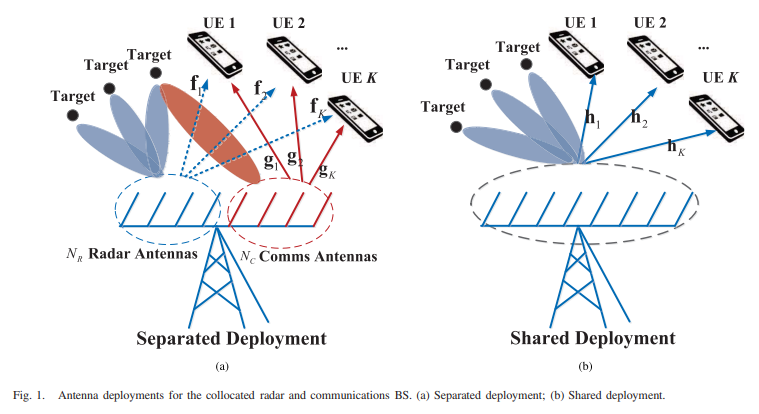
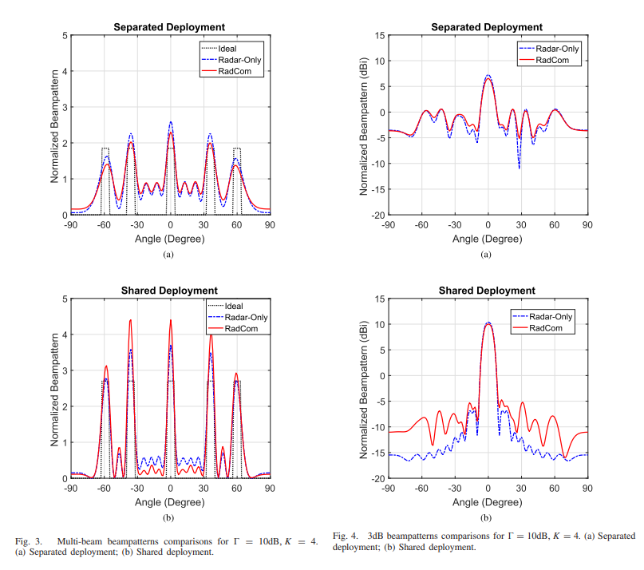
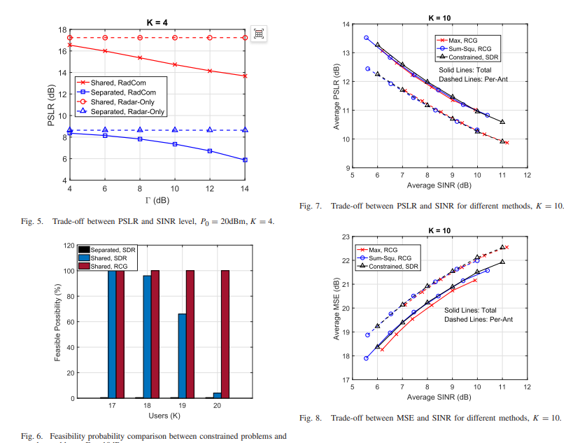
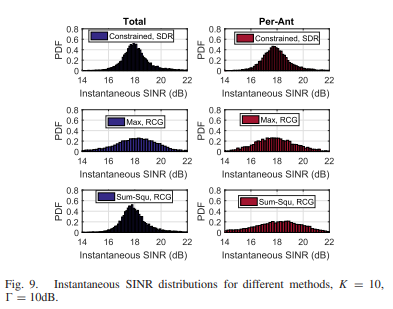
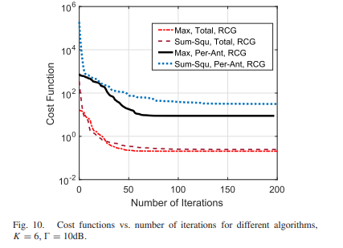
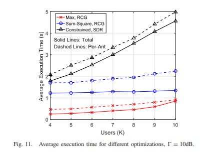
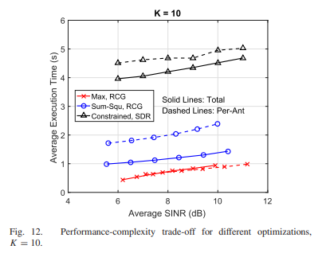

# ISAC: From Coexistence to Integration: Weighted Optimization and Manifold Algorithms in MU-MIMO RadCom Systems with MATLAB Codes

Personal Blog: https://www.cnblogs.com/EWFrontier  
✿MIMO RadCom Beamforming Technology: From Spectrum Coexistence to Joint Transmission Research ✿✿1. Article Title ✿MIMO Radar and MU-MIMO Communication: Beamforming Technology Research from Spectrum Coexistence to Joint Transmission  
✿2. Abstract ✿This paper proposes beamforming technology for joint multi-input multi-output (MIMO) radar-communication (RadCom) systems, which can achieve both downlink user communication and radar target detection functions through a single device. The research considers two working modes: the first is to divide antennas into radar-specific groups and communication-use groups, with radar signals designed to fall into the zero space of the downlink channel, while the communication beamformer achieves matching with the radar beam pattern while meeting communication performance requirements; the second is to share all antennas for transmission, where radar and communication use the same joint waveform, and optimize the detection beam pattern under the premise of ensuring downlink communication performance. To simplify optimization constraints, this paper incorporates the Signal-to-Interference-plus-Noise Ratio (SINR) constraint as a penalty term into the objective function, transforming the original beamforming design into a weighted optimization problem, and solving it through an efficient manifold algorithm. Numerical results show that the performance of shared antenna deployment is significantly better than that of separated deployment. The proposed weighted optimization method has similar computational complexity while achieving comparable performance to the original optimization scheme.  
✿3. Introduction ✿With the expected number of connected devices exceeding 20 billion by 2020, spectrum scarcity has become a critical issue that needs urgent resolution. Currently, the S band and C band in the 2-8GHz range are mainly occupied by radar applications, and future spectrum sharing (CRSS) between radar and communication systems is expected. Existing CRSS research mainly focuses on two directions: one is the coexistence design of existing radar and communication equipment, and the other is the collaborative design of dual-function systems.
In terms of device coexistence, existing schemes include methods such as opportunity spectrum sharing and zero-space projection (NSP), but the former cannot achieve simultaneous operation of dual systems, while the latter may lead to radar performance loss. In terms of collaborative design, traditional solutions require additional control centers for coordination, increasing system complexity, while single antenna dual-function waveform designs face issues such as low data rates.

Addressing these shortcomings, this paper focuses on the design of transmit beamforming in MIMO RadCom systems. By optimizing the beamforming matrix through spatial signal processing, it achieves efficient integration of radar and communication functions without altering the communication modulation method or ensuring data rate. The study proposes two antenna deployment schemes: separation and sharing, designing a weighted optimization algorithm combined with manifold solution, providing a low-complexity, high-performance technical solution for integrated radar-communication.

✿IV. Methodology Introduction ✿ (I)System Model 1  
Separated Deployment: Antennas are divided into radar antenna (N_R) and communication antenna (N_C). Radar signals eliminate interference to communication users through zero-space projection, and communication side optimizes the covariance matrix to match the radar beam pattern while meeting SINR and power constraints.
2  
Sharing Deployment: All N antennas serve both radar and communication simultaneously. Communication signals directly serve as radar detection waveforms, balanced by jointly optimizing the beamforming matrix to balance the quality of the radar beam pattern and communication performance.
 (II)Optimization Problem Construction 1  
Radar Beam Pattern Design: Based on convex optimization methods, by constraining the detection signal covariance matrix, achieving ideal beam pattern matching or specifying a 3dB main lobe width for beam shaping.
2  
Separated Deployment Zero-Pressure Beam Shaping: Project radar signals into the communication channel's zero space, solving non-convex optimization problems using semidefinite relaxation (SDR) technology to obtain the communication beam shaping matrix.
3  
Sharing Deployment Weighted Optimization: Convert SINR constraints into penalty terms (square sum error penalty, maximum SINR penalty), combine total power constraints with single antenna power constraints, constructing a weighted optimization objective function.
(III) Shape algorithm solves the feasible region of weighted optimization problems by mapping it to Riemannian manifolds (complex hyperbolic manifolds, complex oblique manifolds), solving them using the Riemannian Conjugate Gradient (RCG) algorithm. This algorithm efficiently searches for the optimal solution on the manifold through Riemannian gradient computation, vector transmission and contraction mapping, ensuring power constraints are met while reducing computational complexity.
✿V. Conclusion✿This paper proposes a new framework for MIMO RadCom system transmit beamforming, covering both separate and shared antenna deployment schemes, and designs a weighted optimization method based on penalty terms and a shape-solving algorithm. Research shows that: shared antenna deployment significantly outperforms separate deployment in terms of beam pattern quality and downlink SINR trade-off performance; the proposed weighted optimization method achieves an essentially consistent performance with the original constrained optimization scheme while significantly reducing computational complexity (below 50% of traditional methods), achieving excellent performance-complexity balance. This research provides an efficient technical path for radar and communication spectrum sharing, holding significant reference value for the engineering implementation of future integrated communication radar systems.
★

## Images

<!-- PAYMENT_BLOCK -->

## Get this dataset

- Payment link (Stripe): [Buy now](https://buy.stripe.com/3cs8yP7sY87d0vu9AB)
- Payment QR code: 

<!-- /PAYMENT_BLOCK -->
